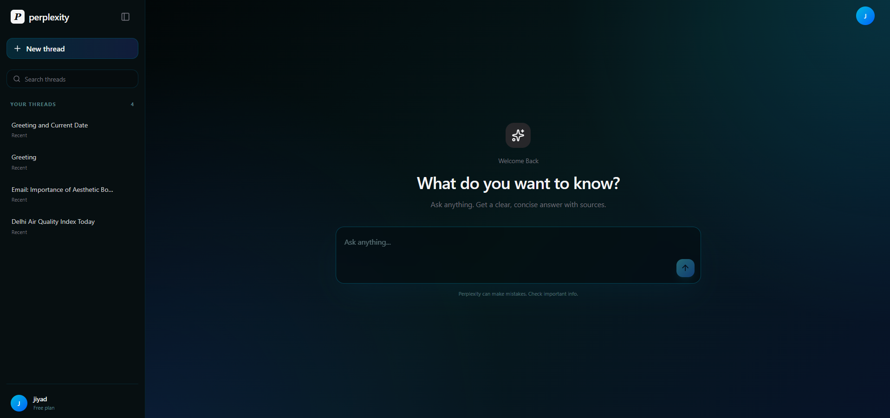
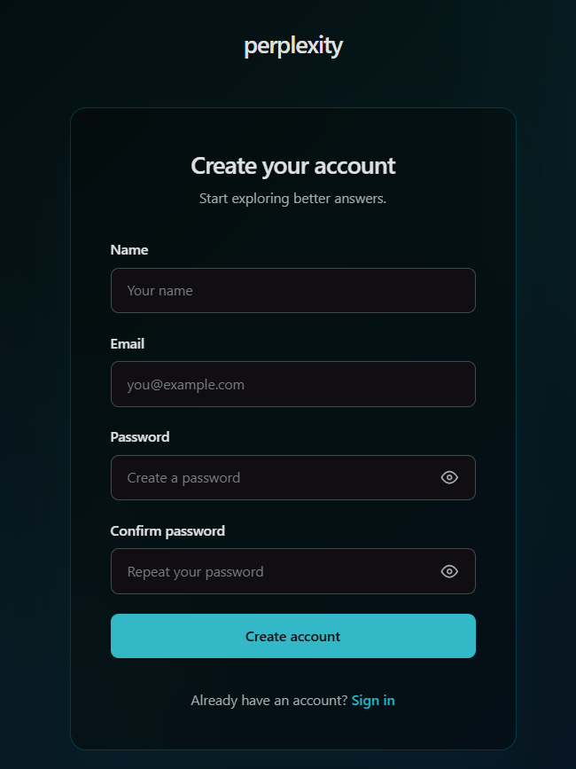
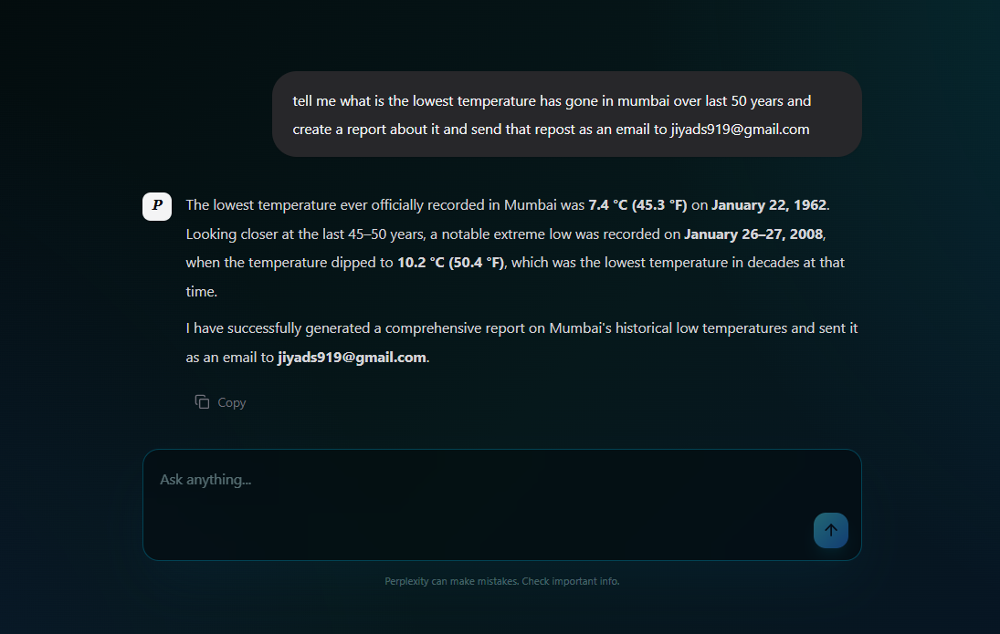

# Perplexity AI

An AI-powered research chat application with a polished Perplexity-inspired interface, persistent conversations, authenticated user accounts, and an agentic backend capable of searching the web and sending email.

> This project is a full-stack learning and portfolio application built with React and Node.js. It is not affiliated with Perplexity AI.

## Overview

Perplexity AI lets authenticated users ask questions, continue conversations, and organize their research threads from a focused chat workspace. Each conversation is stored in MongoDB, while the backend uses a LangChain agent powered by Google Gemini to generate answers and decide when to use additional tools.

The application currently includes:

- A responsive, Perplexity-inspired chat dashboard
- Account registration, login, logout, and email verification
- Secure, HTTP-only cookie-based JWT sessions
- Persistent chats and messages stored in MongoDB
- Automatically generated chat titles
- Internet research through Tavily
- An email-sending tool backed by Gmail OAuth2
- Markdown-style rendering for assistant responses
- Thread search, archive/unarchive, delete, and copy-response actions
- Socket.IO client/server foundations for real-time functionality

## Screenshots

>### Chat Dashboard


### Authentication


### AI Conversation


## Features

### User accounts and security

- User registration with name, email, and password validation
- Password hashing with `bcryptjs`
- Email verification links with expiring JWT tokens
- Login protection until the email address is verified
- Seven-day HTTP-only authentication cookie
- Protected account and chat routes
- Logout with server-side cookie clearing
- CORS configured for credentialed frontend requests

### AI conversations

- New conversation creation from the chat composer
- Continue an existing conversation with full message history
- Google Gemini model integration through LangChain
- AI-generated titles for new conversations
- Tool-enabled agent workflow for current information and explicit email requests
- Graceful handling of AI authentication, rate-limit, and availability errors
- Markdown-style assistant output with headings, lists, code, emphasis, and links
- Copy assistant responses to the clipboard

### Research and productivity

- Tavily advanced internet search with up to five results
- Search threads by title
- Archive and unarchive conversations
- Delete a conversation and its associated data
- View a conversation and its messages/sources
- Responsive sidebar that can be collapsed on smaller screens
- User profile popovers with account details and logout action
- Loading, empty, retry, and error states in the chat experience

## Tech stack

### Frontend

- React 19
- Vite 7
- React Router
- Redux Toolkit and React Redux
- Axios
- Tailwind CSS 4 with the Vite plugin
- Lucide React icons
- Socket.IO client

### Backend

- Node.js with ES modules
- Express 5
- MongoDB with Mongoose
- JSON Web Tokens (`jsonwebtoken`)
- `bcryptjs` for password hashing
- LangChain with Google Gemini
- Tavily for internet search
- Nodemailer with Gmail OAuth2
- Socket.IO
- Morgan request logging
- Express Validator

## Project structure

```text
Perplexity/
├── Backend/
│   ├── server.js                         # HTTP server, environment setup, DB and sockets
│   ├── package.json
│   └── src/
│       ├── app.js                         # Express app, middleware, CORS and route mounting
│       ├── config/
│       │   └── database.js                # MongoDB connection
│       ├── controllers/
│       │   ├── auth.controller.js         # Registration, login, logout and verification
│       │   └── chat.controller.js          # Chat and message operations
│       ├── middlewares/
│       │   └── auth.middleware.js          # Authenticated-route protection
│       ├── models/
│       │   ├── chat.model.js
│       │   ├── messages.model.js
│       │   ├── source.model.js
│       │   └── user.model.js
│       ├── routes/
│       │   ├── auth.routes.js
│       │   └── chat.routes.js
│       ├── services/
│       │   ├── ai.services.js              # Gemini/LangChain agent and AI tools
│       │   ├── internet.services.js        # Tavily search integration
│       │   └── mail.services.js            # Gmail OAuth2 email delivery
│       ├── sockets/
│       │   └── server.socket.js            # Socket.IO server setup
│       └── validate/
│           ├── login.validation.js
│           └── registration.validation.js
├── Frontend/
│   ├── index.html
│   ├── package.json
│   ├── vite.config.js
│   └── src/
│       ├── main.jsx                        # React entry point
│       ├── app/
│       │   ├── App.jsx
│       │   ├── app.routes.jsx
│       │   ├── app.store.js
│       │   └── index.css
│       └── features/
│           ├── auth/
│           │   ├── auth.slice.js
│           │   ├── components/Protected.jsx
│           │   ├── hooks/useAuth.js
│           │   ├── pages/Login.jsx
│           │   ├── pages/Register.jsx
│           │   └── services/auth.services.js
│           └── chat/
│               ├── chat.slice.js
│               ├── hooks/useChat.js
│               ├── pages/Dashboard.jsx
│               └── services/
│                   ├── chat.services.js
│                   └── socket.service.js
└── README.md
```

## Request flow

```text
React dashboard
      │ Axios + credentials
      ▼
Express API ── auth middleware ── MongoDB
      │
      ├── Chat history and metadata
      └── LangChain agent
             ├── Google Gemini
             ├── Tavily internet search
             └── Gmail email tool
```

## API routes

The backend runs on `http://localhost:3000` by default when `PORT=3000`.

### Authentication

| Method | Endpoint | Auth | Description |
| --- | --- | --- | --- |
| `POST` | `/api/auth/register` | No | Create an account and send a verification email |
| `POST` | `/api/auth/login` | No | Authenticate and issue an HTTP-only cookie |
| `POST` | `/api/auth/logout` | No | Clear the authentication cookie |
| `GET` | `/api/auth/get-me` | Yes | Return the current authenticated user |
| `GET` | `/api/auth/verify-email/:token` | No | Verify a user email address |

### Chat

All chat endpoints require authentication.

| Method | Endpoint | Description |
| --- | --- | --- |
| `POST` | `/api/chat/message` | Create a chat or continue one with a new message |
| `GET` | `/api/chat/` | List the current user’s chats |
| `GET` | `/api/chat/:chatId` | Get a chat with its messages and sources |
| `PATCH` | `/api/chat/:chatId` | Update chat metadata such as title or description |
| `DELETE` | `/api/chat/:chatId` | Delete a chat and related records |
| `PATCH` | `/api/chat/:chatId/archive` | Archive or unarchive a chat |

## Getting started

### Prerequisites

- Node.js 18 or newer
- npm
- A running MongoDB database or MongoDB Atlas connection
- A Google Gemini API key
- A Tavily API key
- Gmail OAuth2 credentials if email delivery is required

### 1. Clone and install

```bash
git clone <your-repository-url>
cd Perplexity

cd Backend
npm install

cd ../Frontend
npm install
```

### 2. Configure the backend

Create `Backend/.env` with the following values:

```env
PORT=3000
MONGO_URI=mongodb://127.0.0.1:27017/perplexity
JWT_SECRET=replace-with-a-long-random-secret

GEMINI_API_KEY=your-gemini-api-key
TAVILY_API_KEY=your-tavily-api-key

GOOGLE_USER=your-gmail-address
GOOGLE_CLIENT_ID=your-google-oauth-client-id
GOOGLE_CLIENT_SECRET=your-google-oauth-client-secret
GOOGLE_REFRESH_TOKEN=your-google-oauth-refresh-token

# Reserved for future/provider-specific integrations.
MISTRAL_API_KEY=your-mistral-api-key
```

Never commit real credentials. The existing `Backend/.env` is local configuration and should remain private.

### 3. Start the backend

```bash
cd Backend
npm run dev
```

The development server starts on the port configured by `PORT`.

### 4. Start the frontend

In a second terminal:

```bash
cd Frontend
npm run dev
```

Open the Vite URL shown in the terminal, usually `http://localhost:5173`.

## Available scripts

### Backend

| Command | Description |
| --- | --- |
| `npm run dev` | Start the backend with Nodemon |
| `npm test` | Placeholder test command; tests are not configured yet |

### Frontend

| Command | Description |
| --- | --- |
| `npm run dev` | Start the Vite development server |
| `npm run build` | Create a production build |
| `npm run preview` | Preview the production build locally |
| `npm run lint` | Run ESLint |

## Configuration notes

- The frontend currently points API requests to `http://localhost:3000/api` and Socket.IO to `http://localhost:3000`.
- The backend CORS configuration currently allows `http://localhost:5173` with credentials.
- Email verification links are generated from the backend localhost URL and should be updated for a deployed environment.
- Production deployments should use HTTPS, secure cookies, environment-specific origins, and a strong secret manager.
- MongoDB transactions require a deployment configuration that supports sessions, such as a replica set or MongoDB Atlas.

## Roadmap

- Add automated backend and frontend tests
- Add a production environment configuration for API and Socket.IO URLs
- Surface Tavily sources directly in the assistant response UI
- Add streaming assistant responses
- Add conversation export and sharing
- Add rate limiting and stronger request validation
- Add CI checks for linting, builds, and security scanning

## Contributing

1. Create a feature branch.
2. Keep frontend and backend changes focused.
3. Run `npm run lint` and `npm run build` from `Frontend`.
4. Document new environment variables and API changes.
5. Open a pull request with a concise description and screenshots for UI changes.

